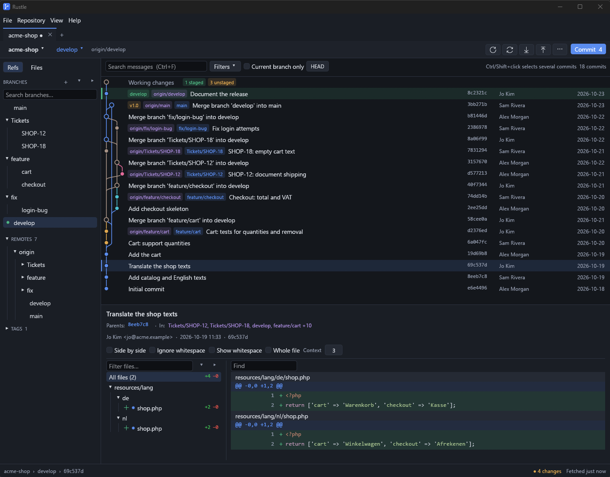
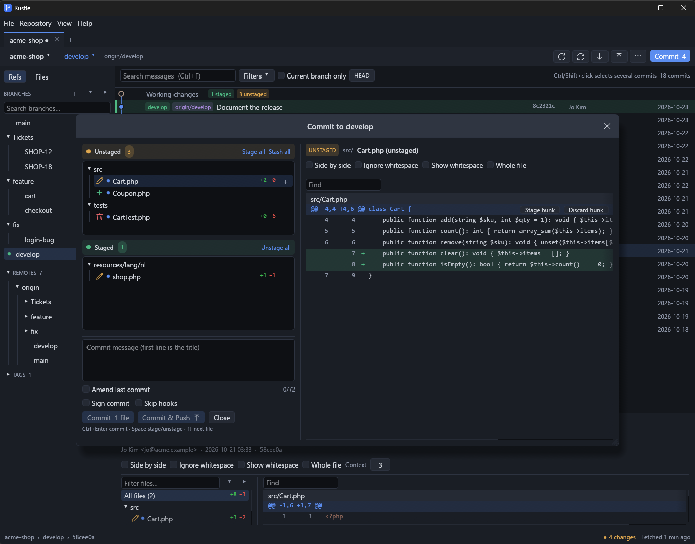

<p align="center"></p>

# Rustle

A fast, native Git client for Windows, written in Rust with [egui](https://github.com/emilk/egui).
It drives the real `git` command line, so your hooks, config, credential helpers, LFS and
submodules all behave exactly as they do in a terminal.



*The screenshots show a fictional demo project; `scripts/make-demo-repo.ps1` recreates it.*

## Features

### Browse history

- **Commit graph** with narrow, smooth coloured lanes (a branch keeps its colour), branch and tag labels,
  relative dates and the checked-out commit highlighted. It loads incrementally, so large repositories
  stay fast. A **Working changes** row sits on top of HEAD when there are uncommitted changes.
- **Commit details** list every changed file in a folder tree with added/removed line counts, an
  **All files** diff, a file filter, parents, the branches that contain the commit, and F3 / Shift+F3 to
  jump between changes.
- **Search and filter** by message, author, dates, file history, "current branch only", one chosen branch,
  or **text that was added or removed** (`git log -S`). Typing a commit hash and pressing Enter jumps to it;
  the arrow keys or `j`/`k` move through the list.
- **Compare** two branches (commits only on either side and the changed files), **review** a branch against
  the base branch with a per-file "viewed" checkbox, preview a merge or a rebase before you run it.
- **File browser** for the working tree or any commit, content search, syntax-highlighted file viewer,
  blame, file history and the reflog.
- **Repository dashboard**: branches without activity, the largest files and commits per week per author.

### Commit

- **Commit window** with the unstaged and staged files as folder trees, line counts per file, status icons,
  stage by file, **hunk or single line**, discard, amend, stash a file or everything, **Commit & Push**,
  and keyboard use (`Space` stages and moves on, arrows move through the files).
- The commit message is prefilled from `commit.template`, the merge message, or the ticket key in the
  branch name (`Tickets/ABC-12` gives `ABC-12: `). Optional **signing** (GPG or SSH), "skip hooks", and the
  output of hooks is shown.
- **Checks before committing:** secrets (`.env` files, keys, `password=…`, AWS keys) and files over 50 MB
  are reported first.
- **Fixup:** fold staged changes into an older commit. **Guided bisect** to find the commit that broke something.
- Diffs with syntax highlighting, line numbers, side-by-side, intra-line highlighting, find in diff,
  visible whitespace, whole-file view, and **image diffs** (side by side, swipe, onion skin).
- **Conflicts:** a **three-way editor** with a live result per conflict (take ours, theirs, both, the base, or
  write your own), next / previous navigation, or open your configured **external merge tool**.

### Branches and remotes

- Branches in **folders** (`Tickets/…`), **pinned** branches and colours, search, expand/collapse all,
  create a branch inside a folder from the right-click menu.
- Per branch: ahead/behind badges, push or publish, fast-forward without checking out, merge, rebase,
  compare, review, open a **pull request** link on GitHub or GitLab, copy or open links to a commit,
  branch or file.
- **Clean up:** delete branches that are fully merged (local or remote), and **undo** the last action.
  If a checkout is blocked by local changes, Rustle offers to stash, switch and re-apply.
- **Safety net:** a hard reset or a discard first saves HEAD and your tracked changes (**Repository →
  Backups…** restores them), and a force push lists the commits on the remote that would be lost.
- Tags (annotations, delete on the remote), stashes (with a preview), submodules, worktrees (double-click
  opens a tab) and Git LFS in the sidebar. Fetch or prune a single remote.
- Several commits at once: Ctrl/Shift+click, then squash, cherry-pick, revert, compare, or copy them as
  markdown, text or CSV. Drag an unpushed commit onto another to reorder. Interactive rebase.
- Export a commit as a patch or apply a patch file. Fetch or pull **all open repositories** at once.

### The app

- **Menu bar**, **command palette** (`Ctrl+K`: actions, branches and commits, your latest actions first),
  tabs that show changes and ahead/behind, a status bar with a breadcrumb, a keyboard shortcut overview
  (`?`) and **session restore**.
- Dark and light theme (or follow Windows), accent colours, high contrast, adjustable text size.
- Live updates: the view reloads when files or refs change, and a background fetch keeps the badges current
  (it never asks for a password). Authentication prompts for HTTPS tokens and SSH passphrases.
- Self-update from GitHub releases, with a "What's new" window after an update.



## Requirements

- Windows 10/11 (the code is portable, but only Windows is tested and packaged)
- [Git for Windows](https://git-scm.com/download/win) (Rustle looks in `PATH` and the default install
  locations; you can also set the path in Settings). The merge preview needs git 2.38 or newer.

## Install

Download the installer or the portable zip from the GitHub releases page, or build it yourself
(below). The installer can add an *Open with Rustle* entry to the folder context menu.

```
rustle.exe [path-to-repository] [--commit]
```

Without a path Rustle reopens the tabs of your last session. `--commit` opens the commit window right away.

## Settings

*File → Settings…* (`Ctrl+,`): theme and accent colour, text size, pull strategy, diff options,
background fetch, editor command, updates, your git identity, and a **ticket URL** (for example
`https://tracker.example.com/browse/{id}`) that turns ticket keys in commit messages into links.
*Repository → Repository settings…* edits remotes and common git configuration for the current repository.

## Updates

Rustle checks the GitHub releases of this project at most once a day (switch it off, or point it
at another repository, in *Settings → Updates*). When a newer version exists, an **Update available**
button appears in the tab bar. *Update now* downloads `Rustle-<version>-portable.zip`, verifies it
against the published `.sha256` file, replaces `rustle.exe` and restarts. The old file is kept as
`rustle.exe.old` until the next start. If Rustle cannot write to its own folder (for example after a
machine-wide install in *Program Files*), it offers the releases page instead. The repository has to be
public for the update check to work.

The checksum catches corrupt downloads; it is not a signature, so it cannot detect a tampered
release. Code signing (see `scripts/package.ps1`) would be needed for that.

## Releasing

1. Raise `version` in `Cargo.toml` and describe the changes in `CHANGELOG.md` (the section is shown in the
   "What's new" window).
2. Make sure `cargo fmt --all -- --check`, `cargo clippy --workspace --all-targets -- -D warnings` and
   `cargo test --workspace` pass; CI runs the same.
3. Commit, then tag and push: `git tag v0.6.0` and `git push origin main v0.6.0`.
4. The *Release* workflow builds, tests and publishes `Rustle-<version>-portable.zip`, its `.sha256`
   and the installer. The updater relies on exactly these asset names, and on the tag being `v<version>`.

## Keyboard shortcuts

Press `?` in the app for the full overview.

| Shortcut | Action |
| --- | --- |
| `Ctrl+K` | Command palette |
| `Ctrl+O` | Open a repository |
| `Ctrl+T` / `Ctrl+W` | New / close tab |
| `Ctrl+Tab` | Next tab |
| `Ctrl+,` | Settings |
| `F5` | Refresh |
| `Ctrl+F` | Search commits |
| `↑` `↓` or `j` `k` | Move through the commit list |
| `F3` / `Shift+F3` | Next / previous change in a diff |
| `Ctrl+Enter` | Commit (in the commit window) |
| `Space` | Stage or unstage the selected file and go to the next (commit window) |
| `Esc` | Close the top-most dialog |

## Build from source

```
cargo run -p rustle-app          # debug build (dependencies are optimised, so it is quick)
cargo test --workspace
cargo build --release -p rustle-app
.\scripts\package.ps1            # portable zip (+ installer if Inno Setup 6 is installed)
```

Two scripts create demo repositories to try Rustle on: `.\scripts\make-test-repo.ps1` (small, with a remote,
a merge and local changes) and `.\scripts\make-demo-repo.ps1` (a fictional shop with three authors,
folders, ticket branches and local changes; used for the screenshots).

## Project layout

- `crates/rustle-core` — `GitRunner` (git invocation with safe defaults), parsers, diff/patch
  builder, commit graph lanes (including lane colours), conflict parsing, secret heuristics, and all
  git operations. No UI dependencies.
- `crates/rustle-app` — the egui application. It talks to git only through a worker thread per
  tab (`worker.rs`), never directly from the UI. `panels.rs`, `commit_window.rs`, `branches.rs` and
  `windows.rs` hold most of the screens; `theme.rs` has the colours, text scale and shared widgets.
- `installer/` — Inno Setup script. `scripts/` — packaging and demo scripts. `.github/` — CI and release workflows.

Design rules: git output is handled as bytes and only converted (lossily) to UTF-8 for display; the
UI thread never blocks on git; every destructive action asks for confirmation.

## Data and logs

Settings, the recent-repositories list and logs live in `%APPDATA%\Rustle` (`settings.ini`,
`recent.txt`, `rustle.log`, `crash.log`). Pinned branches and branch colours are stored per repository in
`.git/rustle-pins` and `.git/rustle-colors`; safety backups are refs under `refs/rustle-backup/`.
Set `RUSTLE_LOG=debug` to log every git command.

## Known limitations

- Long lines in diffs scroll sideways instead of wrapping.
- File names that are not valid UTF-8 are preserved on Linux and macOS; on Windows git converts names to UTF-8
  itself, so the case hardly occurs there.
- Interactive rebase, squash and reordering work on the first-parent history of the current branch and refuse
  ranges that contain merge commits.
- Git LFS features need `git-lfs` to be installed.
- Pull request and commit links work for GitHub and GitLab remotes only; there is no CI status.
- Backups cover HEAD and tracked changes, not untracked files. The hooks window only lists
  `.git/hooks` (not `core.hooksPath`).
- Hunks cannot be split or edited before staging, and the graph does not show signature status.
- Binaries are unsigned unless you provide a certificate (see `scripts/package.ps1`), so Windows
  SmartScreen may warn on first run.

## License

MIT — see [LICENSE](LICENSE).
